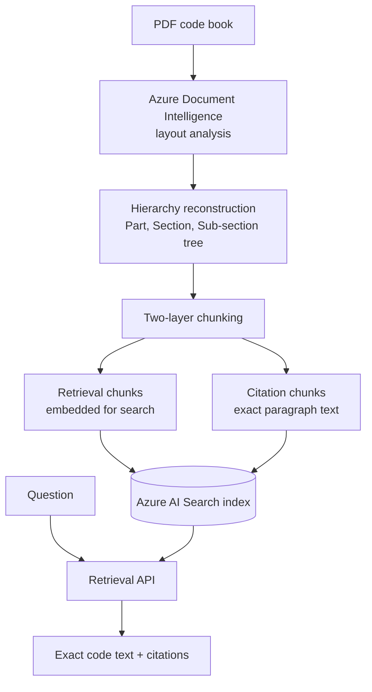

# Elevator Code RAG System: Project Overview

A retrieval back end that lets inspectors ask plain-English questions about ASME elevator and escalator safety codes and get back the **exact regulatory text**, with section numbers and page citations.

This page describes the problem, the design and my contribution. It contains no source code and no customer data.

---

## The problem

Inspectors answer questions every day such as:

- "What are the requirements for pump relief valves?"
- "What is the maximum leveling zone distance?"

The answers live in large safety code books (ASME A17.1, A17.2, A17.3, A17.5, A17.6, A17.7, A17.8, A18.1 and related standards). In total that is **45 documents across 14 standards**, with editions spanning more than four decades, each hundreds of pages long. Some are clean digital PDFs; older ones are scanned, two-column pages with OCR noise.

A general-purpose chatbot is not good enough here. It paraphrases, mixes up editions and sometimes invents rules. For safety regulations, an inspector needs the actual rule and its exact source.

## The solution

A Retrieval-Augmented Generation (RAG) back end whose job is:

> **Question in, correct code paragraphs with section number and page citation out.**

The system does not write the final answer. It hands verified source text to a web application, whose language model answers using only that text. Every statement can be traced to a specific section and page of a specific edition.

## How it works

### 1. Reading the PDF
Azure Document Intelligence extracts the paragraphs and their pages. The output is mostly flat: a long list of paragraphs with an unreliable sense of structure.

### 2. Rebuilding the document structure
Safety codes are deeply nested: section 2.26.5.1 sits inside 2.26.5, inside 2.26, inside Part 2. A rule means little without knowing where it belongs. The parser rebuilds this tree from the flat output. It finds headings the layout model missed, handles many numbering styles across decades of editions, copes with scanned-document noise, and fills in missing parent sections so the tree is always complete. Nothing is tailored to a single document: every fix had to work across all 45.

### 3. Two layers of chunks

| Layer | Contents | Purpose |
|---|---|---|
| Retrieval chunks | Groups of paragraphs (100 to 600 tokens) prefixed with their location in the document | Used only to find the right sections; embedded for search |
| Citation chunks | One exact, unmodified paragraph each | What is shown and quoted; never altered or summarised |

The location prefix matters: short rules such as "the clearance shall be not less than 25 mm" look almost identical to a search engine until you add where they sit in the document.

### 4. Three-stage retrieval
1. **Hybrid search:** keyword search, vector search and a semantic re-ranker together find the relevant sections.
2. **Full section fetch:** the complete, exact text of each matched section and all its sub-sections is retrieved, so no part of a rule is cut off.
3. **Cross-reference following:** when a rule says "shall comply with 2.9", the referenced section is fetched too, even if it is in a different document.

The result is returned as clean, ordered, citable text through a serverless web API.

## What I built

- The document parser that turns layout output into a complete section tree
- The chunking pipeline, with metadata such as section number, edition year, part, page range and cross-references
- The hybrid search index on Azure AI Search
- The retrieval API (Azure Functions), which can scope a query to a few selected documents and returns answers end to end in under 10 seconds; the logic that chooses the documents sits in the web application
- Automatic ingestion: a new PDF uploaded to cloud storage can trigger the whole pipeline
- Structural checks: the parser fills in missing sections, detects orphaned paragraphs and re-attaches them, and produces a health report for each document
- An evaluation harness (see below)
- Technical handoff documentation and a processing guide

I developed the system with Claude Code as my main development tool, reviewing and testing the generated code.

## Evaluation

An automated test program checks the pipeline end to end, from question to retrieved text to final answer. It has **225 test questions across 5 documents**. Each question comes with the section that should answer it and a key piece of the expected answer (for example a number or a required phrase). For every question it checks three things separately:

- **Section retrieved:** was the correct section found?
- **Content in context:** does the expected text appear in what was retrieved?
- **Content in answer:** did the final answer use it?

Every failure gets a written diagnosis, and the report lists every section the search returned in ranked order. This shows whether the right passage was never retrieved or was retrieved but ranked too low. Separating retrieval failures from answer failures matters: fixing search does not help if the text was already found, and changing the prompt does not help if the text was never retrieved.

## Technology

Python, Azure Document Intelligence, Azure AI Search (keyword, vector and semantic ranking), Azure OpenAI embeddings, Azure Functions, Azure Blob Storage.
